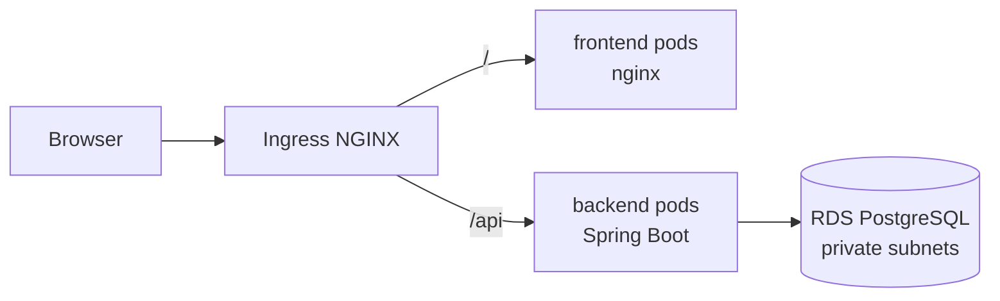
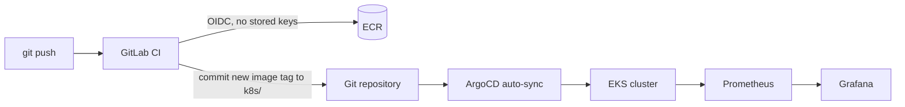

# BMW Cloud App: GitOps Platform on AWS EKS

A BMW car catalog web application deployed on Amazon EKS with a GitOps workflow. The
application is deliberately small. The focus is the platform around it: Terraform
infrastructure, containerised builds, a GitLab CI pipeline that authenticates to AWS
without stored keys, ArgoCD deployments, and Prometheus and Grafana monitoring.

> Learning and portfolio project. Not affiliated with BMW AG. Car photos belong to their
> owners, and all prices are sample values.

## Table of contents

1. [Project status](#project-status)
2. [Architecture](#architecture)
3. [Tech stack](#tech-stack)
4. [Repository layout](#repository-layout)
5. [Application](#application)
6. [Access the application](#access-the-application)
   - [Run locally](#run-locally)
7. [Configuration](#configuration)
8. [API reference](#api-reference)
9. [Infrastructure (Terraform)](#infrastructure-terraform)
10. [CI/CD flow](#cicd-flow)
11. [Kubernetes](#kubernetes)
12. [Observability](#observability)
13. [Security](#security)
14. [Cost control](#cost-control)
15. [Troubleshooting](#troubleshooting)
16. [Roadmap and known gaps](#roadmap-and-known-gaps)

## Project status

| Area | Status |
|---|---|
| Catalog service (Spring Boot, PostgreSQL, Flyway) | Done |
| Frontend (static site, nginx reverse proxy) | Done |
| Dockerfiles and Docker Compose with env-based config | Done |
| Terraform: state bucket, ECR, GitLab OIDC role | Done |
| Terraform: VPC, EKS, RDS PostgreSQL | Done |
| Kubernetes manifests, application served from EKS | Done |
| GitLab CI: build, push to ECR, update manifests | Done |
| ArgoCD auto-sync | Done |
| Prometheus and Grafana | Done |

## Architecture

### Request path



### Delivery path (GitOps)



CI never talks to the cluster. It builds the images, pushes them to ECR, and commits the
new tag into the `k8s/` manifests. ArgoCD pulls the change and applies it. A rollback is a
`git revert` of that commit.

> Add the exported architecture diagram here: ``

## Tech stack

| Layer | Technology |
|---|---|
| Backend | Java 17, Spring Boot 4.1, Spring Data JPA, Flyway, Actuator |
| Database | PostgreSQL 16 locally, Amazon RDS (`db.t4g.micro`) on AWS |
| Frontend | HTML, CSS, JavaScript, nginx |
| Containers | Docker (multi-stage build, non-root user), Docker Compose |
| Infrastructure as code | Terraform >= 1.10, AWS provider 5.x |
| Cloud | AWS (ap-south-1): VPC, EKS, RDS, ECR, S3, IAM, Secrets Manager |
| CI | GitLab CI with AWS OIDC federation |
| CD | ArgoCD |
| Ingress | NGINX Ingress Controller |
| Observability | kube-prometheus-stack (Prometheus, Grafana, Alertmanager) |

## Repository layout

The project lives in one repository.

```
.
├── backend/                 Spring Boot catalog service
│   ├── Dockerfile
│   └── src/main/
│       ├── java/...         controller, repository, entity, DTO
│       └── resources/
│           ├── application.yml
│           └── db/migration/   Flyway migrations (schema, seed data)
├── frontend/                Static site served by nginx
│   ├── Dockerfile
│   ├── nginx.conf
│   └── index.html
├── bootstrap/               Terraform: state bucket, ECR repos, GitLab OIDC role
├── network/                 Terraform: VPC, subnets, NAT gateway
├── eks/                     Terraform: EKS cluster and managed node group
├── rds/                     Terraform: RDS PostgreSQL and security group
├── k8s/                     Deployments, Services, Ingress (watched by ArgoCD)
├── monitoring/              Helm values for kube-prometheus-stack
├── .gitlab-ci.yml           CI pipeline
├── docker-compose.yml       Local development stack
├── .env.example             Local configuration template
└── README.md
```

## Application

The catalog service stores BMW models (series, body type, fuel type, power, price,
description, image URL). The frontend lists them with series filters, search, sorting,
and a detail view.

- **Images are not stored in the database.** `cars.image_url` holds a URL, which keeps the
  database small and backups fast.
- **Schema is code.** Flyway migrations create the schema and seed data. Hibernate runs
  with `ddl-auto: validate`.
- **Twelve-factor configuration.** Database settings come from environment variables with
  no defaults, so a missing value stops startup with a clear error.
- **Same image everywhere.** The image that runs locally is the one deployed to EKS. Only
  the environment variables change.
- **Operational endpoints.** Actuator exposes health (with liveness and readiness probes)
  and Prometheus metrics.

## Access the application

On AWS there is a single public address: the load balancer created by the NGINX Ingress
controller. There is no separate API domain or API gateway. The website and the API share
the same host, and the Ingress routes by path:

| URL | Goes to |
|---|---|
| `http://a85d65907072f44fa99aa7206ceb8e8f-355253792.ap-south-1.elb.amazonaws.com/` | Frontend (nginx) |
| `http://a85d65907072f44fa99aa7206ceb8e8f-355253792.ap-south-1.elb.amazonaws.com/api/cars` | Backend (Spring Boot) |

Find the address:

```bash
kubectl get svc -n ingress-nginx
kubectl get ingress bmw-ingress
```

Use the `EXTERNAL-IP` (a hostname ending in `elb.amazonaws.com`). Replace
`a85d65907072f44fa99aa7206ceb8e8f-355253792.ap-south-1.elb.amazonaws.com` in this README with your real one, or remove it if you destroy
the environment after demos, since the address changes on every rebuild.

```bash
curl http://a85d65907072f44fa99aa7206ceb8e8f-355253792.ap-south-1.elb.amazonaws.com/api/cars
```

The frontend calls the relative path `/api/cars`, so it needs no API address in its code.

### Run locally

Requirements: Docker with the Compose plugin.

```bash
git clone https://github.com/AbhayKiran/bmw-Cloud-app.git
cd bmw-Cloud-app
cp .env.example .env
# edit .env and set DB_NAME, DB_USER and DB_PASSWORD
docker compose up -d --build
docker compose ps
```

Open <http://localhost:8000>.

| Command | Purpose |
|---|---|
| `docker compose up -d` | Start all services |
| `docker compose down` | Stop all services (data is kept) |
| `docker compose down -v` | Stop and delete the database volume |
| `docker compose up -d --build` | Rebuild after code changes |
| `docker compose logs -f backend` | Follow backend logs |

## Configuration

| Variable | Description |
|---|---|
| `DB_NAME`, `DB_USER`, `DB_PASSWORD` | Database credentials |
| `DB_HOST`, `DB_PORT` | Set by Compose locally. On EKS they point to the RDS endpoint |
| `DB_HOST_PORT`, `BACKEND_HOST_PORT`, `WEB_PORT` | Ports published on the host (Compose only) |

On EKS the backend reads its database settings from the Kubernetes Secret `bmw-db-secret`
(`envFrom`). `.env` is ignored by Git, and only `.env.example` is committed.

## API reference

All paths are relative to the application URL (the AWS load balancer URL on EKS, or `http://localhost:8000` locally).

| Method | Path | Description |
|---|---|---|
| GET | `/api/cars` | List cars. Optional `?series=M` filter |
| GET | `/api/cars/{id}` | Get one car |
| POST | `/api/cars` | Create a car |
| PUT | `/api/cars/{id}` | Update a car |
| DELETE | `/api/cars/{id}` | Delete a car |
| GET | `/actuator/health` | Health, including liveness and readiness probes |
| GET | `/actuator/prometheus` | Prometheus metrics |

## Infrastructure (Terraform)

Each folder is its own Terraform stack. Stacks share data through remote state in S3, so
apply them in this order:

| Order | Stack | Creates |
|---|---|---|
| 1 | `bootstrap/` | S3 state bucket (versioned, encrypted, public access blocked), ECR repositories with scan on push, GitLab OIDC provider and CI role |
| 2 | `network/` | VPC with public and private subnets, single NAT gateway, EKS subnet tags |
| 3 | `eks/` | EKS cluster (terraform-aws-modules/eks) and one managed node group in private subnets |
| 4 | `rds/` | PostgreSQL 16 in private subnets, security group, password read from AWS Secrets Manager |

```bash
cd network
terraform init -backend-config=backend.hcl
terraform plan
terraform apply
```

Repeat for `eks/` and `rds/`. The RDS password is never stored in code. Terraform reads it
from the Secrets Manager secret `bmw/dev/db-credentials`.

## CI/CD flow

`.gitlab-ci.yml` has two stages:

1. **build**: the job assumes an IAM role through GitLab OIDC (`AssumeRoleWithWebIdentity`),
   logs in to ECR, then builds and pushes the backend and frontend images tagged with the
   commit SHA and `latest`.
2. **update_manifest**: the job writes the new image tag into `k8s/*.yaml` and commits it.

ArgoCD detects the commit and syncs the cluster. To roll back, revert the commit that
changed the image tag.

Required GitLab CI/CD variables: `AWS_ROLE_ARN`, `AWS_ACCOUNT_ID`, `AWS_DEFAULT_REGION`,
and `GITLAB_PUSH_TOKEN`.

## Kubernetes

| File | Contents |
|---|---|
| `k8s/backend-deployment.yaml` | Backend Deployment (2 replicas) and ClusterIP Service on 8080 |
| `k8s/frontend-deployment.yaml` | Frontend Deployment (2 replicas) and Service on 80 |
| `k8s/ingress.yaml` | NGINX Ingress: `/api` to the backend, `/` to the frontend |

## Observability

`monitoring/prometheus-values.yaml` configures kube-prometheus-stack:

- Prometheus with 15 days of retention on a 25 GiB gp3 volume
- Grafana with persistent storage and anonymous access disabled
- Alertmanager with persistent storage

The backend exposes JVM, HTTP, and datasource metrics at `/actuator/prometheus`.

## Security

- No long-lived AWS keys in CI. GitLab authenticates with short-lived OIDC credentials.
- The database password lives in AWS Secrets Manager and in a Kubernetes Secret, never in Git.
- RDS is in private subnets and is not publicly accessible. Its security group allows
  PostgreSQL only from inside the VPC.
- ECR repositories scan images on push.
- The backend container runs as a non-root user.
- Terraform state is stored in a versioned, encrypted S3 bucket with public access blocked.

## Cost control

EKS, the NAT gateway, load balancers, and RDS bill while they exist.

- Set an AWS Budget alert before creating resources.
- Run `terraform destroy` in reverse order (`rds`, `eks`, `network`) when you stop.
- The dev environment uses one NAT gateway, one worker node, and a micro RDS instance.

## Troubleshooting

| Symptom | Likely cause and fix |
|---|---|
| `password authentication failed` locally | The database volume was created with different credentials. Run `docker compose down -v`, then `up -d`. Also check that no `DB_*` variable is set in your shell, because shell variables override `.env` |
| `set DB_PASSWORD in .env` | A required variable is missing in `.env` |
| EKS `NodeCreationFailure` | Check the node IAM role policies, the VPC CNI add-on, endpoint access, and subnet routes |
| Backend pods crash on EKS | Check `bmw-db-secret` and that the RDS security group allows the VPC CIDR |
| ArgoCD stays on the old version | Confirm the CI commit really changed the image tag in `k8s/` |
| `/api/cars` returns 404 | The controller classes are missing from the image, or the Ingress path is wrong |

## Roadmap and known gaps

- [x] Spring Boot catalog service, frontend, Docker Compose
- [x] Terraform: bootstrap, network, EKS, RDS
- [x] GitLab CI with OIDC, ECR push, manifest update
- [x] ArgoCD auto-sync
- [x] Prometheus and Grafana
- [ ] Readiness and liveness probes, and resource requests and limits, in the Deployments
- [ ] Test stage in the pipeline
- [ ] Architecture diagram image and screenshots
- [ ] Test drive booking microservice with its own database

## Author

Built by Abhay as a hands-on DevOps and platform engineering project.
